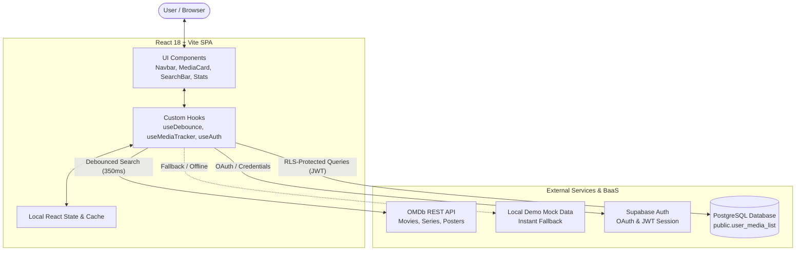

# CinePulse – TV Show & Media Tracker

[](https://react.dev/)
[](https://www.typescriptlang.org/)
[](https://vitejs.dev/)
[](https://tailwindcss.com/)
[](https://supabase.com/)
[](LICENSE)

**CinePulse** is a production-grade, dark-mode cinema tracking web application inspired by Letterboxd and Trakt.tv. It delivers real-time search across millions of movies, television series, and episodes via the OMDb API with custom debouncing, granular status/season/episode tracking, viewing analytics dashboards, and cloud synchronization powered by Supabase with Row Level Security (RLS).

---

## 🌟 Key Highlights & Features

- **Live Debounced Search & Discovery:** Custom `useDebounce` hook guarantees optimal network throttling (350ms window) against the OMDb API with type categorization (`Movies`, `Series`, `Episodes`) and release year filtering.
- **Zero-Config Fallback & Demo Mode:** Works out-of-the-box without requiring API credentials. Ships with a curated fallback catalogue and transparent `localStorage` persistence for guest recruiters and offline testing.
- **Granular Media Progress Tracking:**
  - Status classification: `Watching`, `Completed`, `Plan to Watch`, and `Dropped`.
  - In-place quick episode stepper (`S01E03`) with interactive decrement/increment controls.
  - Personal 1–10 star scoring, review notes, and completion date timestamping.
- **Analytics & Insights Dashboard:**
  - Dynamic runtime aggregation (total hours and days invested).
  - Visual genre affinity bar breakdowns.
  - 10-tier rating distribution histograms.
  - Daily completion streaks and longest historical streaks.
- **Enterprise-Grade Security Architecture:** Direct client-to-database communication secured via PostgreSQL Row Level Security (`auth.uid() = user_id`) and Google OAuth / Email Auth.
- **Aesthetic Cinema Design:** Custom dark palette (`ink-950`), glowing pulse accents, smooth shimmer skeleton loaders, glassmorphism modals, and full mobile-first navigation.

---

## 🏗️ Architecture & Data Flow



---

## 🔒 Security: Supabase & Row Level Security (RLS)

Rather than maintaining a custom Node/Express backend that forwards queries, CinePulse leverages Supabase's **Row Level Security (RLS)** in PostgreSQL. The browser holds the public `anon` key, while authorization is enforced at the database kernel level:

1. Every request transmits the user's signed JWT in the `Authorization` header.
2. PostgreSQL extracts `auth.uid()` from the token claim.
3. RLS policies guarantee users can only read, insert, update, or delete records matching their `user_id`:

```sql
-- Enforce RLS on user_media_list
ALTER TABLE public.user_media_list ENABLE ROW LEVEL SECURITY;
ALTER TABLE public.user_media_list FORCE ROW LEVEL SECURITY;

CREATE POLICY "Users can read own media"
  ON public.user_media_list FOR SELECT
  TO authenticated
  USING (auth.uid() = user_id);

CREATE POLICY "Users can insert own media"
  ON public.user_media_list FOR INSERT
  TO authenticated
  WITH CHECK (auth.uid() = user_id);

CREATE POLICY "Users can update own media"
  ON public.user_media_list FOR UPDATE
  TO authenticated
  USING (auth.uid() = user_id)
  WITH CHECK (auth.uid() = user_id);

CREATE POLICY "Users can delete own media"
  ON public.user_media_list FOR DELETE
  TO authenticated
  USING (auth.uid() = user_id);
```

---

## 📁 Repository Structure

```text
cinepulse-media-tracker/
├── .env.example                     # Environment variable blueprint
├── .gitignore                       # Git ignore rules (includes LEARNING_GUIDE.md)
├── Dockerfile                       # Multi-stage production build (Node + Nginx)
├── docker-compose.yml               # One-command container orchestration
├── nginx.conf                       # Production Nginx SPA routing configuration
├── index.html                       # HTML5 entry with preconnected Google Fonts
├── package.json                     # Project manifest and dependencies
├── postcss.config.js                # PostCSS config with Tailwind CSS
├── tailwind.config.js               # Cinema theme design tokens and keyframes
├── tsconfig.json                    # Strict TypeScript compiler options
├── vite.config.ts                   # Vite bundler configuration
├── public/
│   └── favicon.svg                  # CinePulse pulse-wave brand icon
├── src/
│   ├── App.tsx                      # Root orchestration, views, and modal triggers
│   ├── main.tsx                     # React 18 DOM mount point
│   ├── index.css                    # Tailwind directives and glassmorphism utilities
│   ├── vite-env.d.ts                # Vite client environment type declarations
│   ├── components/
│   │   ├── AuthModal.tsx            # Supabase Google OAuth + Email auth modal
│   │   ├── MediaCard.tsx            # Poster presentation, episode controls, card badges
│   │   ├── Navbar.tsx               # Responsive header and mobile navigation tabs
│   │   ├── RatingModal.tsx          # 1–10 star scoring, notes, and season/episode editor
│   │   ├── SearchBar.tsx            # Keyword, media type, and year filter controls
│   │   ├── StatsOverview.tsx        # Hours watched, streaks, genre & rating charts
│   │   └── WatchlistTabs.tsx        # Categorized status pills with count badges
│   ├── hooks/
│   │   ├── useAuth.ts               # Supabase session lifecycle and guest management
│   │   ├── useDebounce.ts           # Debounced input hook for API throttle protection
│   │   └── useMediaTracker.ts       # Optimistic CRUD, local fallback, and analytics calculations
│   ├── services/
│   │   ├── omdbService.ts           # OMDb API client with fallback catalogue
│   │   └── supabaseClient.ts        # Supabase client instantiation
│   └── types/
│       └── media.ts                 # Domain models, enums, and stats interfaces
└── supabase/
    └── migrations/
        └── 001_initial_schema.sql   # PostgreSQL DDL, triggers, and RLS policies
```

---

## 🚀 Getting Started

### 1. Prerequisites
- **Node.js** >= 18.x
- **npm** >= 9.x
- *(Optional)* Free [OMDb API Key](https://www.omdbapi.com/apikey.aspx)
- *(Optional)* Free [Supabase Account](https://supabase.com/)

### 2. Installation & Local Development
```bash
# Clone the repository
git clone https://github.com/ddd2221/cinepulse-media-tracker.git
cd cinepulse-media-tracker

# Install dependencies
npm install

# Start Vite development server
npm run dev
```

The application will be live at `http://localhost:5173`. If `.env` is omitted, the application seamlessly launches into **Guest Demo Mode** utilizing the bundled offline catalogue and browser `localStorage`.

### 3. Environment Variables Configuration (Optional)
To connect your own cloud database and live OMDb API:
```bash
cp .env.example .env
```
Fill in your credentials:
```env
VITE_SUPABASE_URL=https://your-project-id.supabase.co
VITE_SUPABASE_ANON_KEY=your-supabase-anon-key
VITE_OMDB_API_KEY=your-omdb-api-key
```

### 4. Supabase Database Migration
Execute `supabase/migrations/001_initial_schema.sql` directly inside the **SQL Editor** of your Supabase Dashboard or deploy via the Supabase CLI:
```bash
supabase db push
```

### 5. Production Build & Preview
```bash
# Typecheck and bundle assets
npm run build

# Preview production build locally
npm run preview
```

---

## 🐳 Docker Deployment

A multi-stage `Dockerfile` and `docker-compose.yml` are provided for containerized environments:

```bash
# Build and start container in detached mode
docker compose up -d --build

# Access the application
open http://localhost:8080

# Stop container
docker compose down
```

---

## 🧪 Testing & Code Quality
- **TypeScript:** Strict type checking (`tsc -b`) ensures zero `any` leaks.
- **ESM-first:** Clean, tree-shakeable ES modules compiled via Vite.
- **Accessibility:** ARIA attributes, semantic headings (`h1`–`h3`), keyboard focus trap on modals (`Escape` / `Tab`), and reduced-motion media query support.

---

## 📄 License
This project is open-source under the [MIT License](LICENSE).
